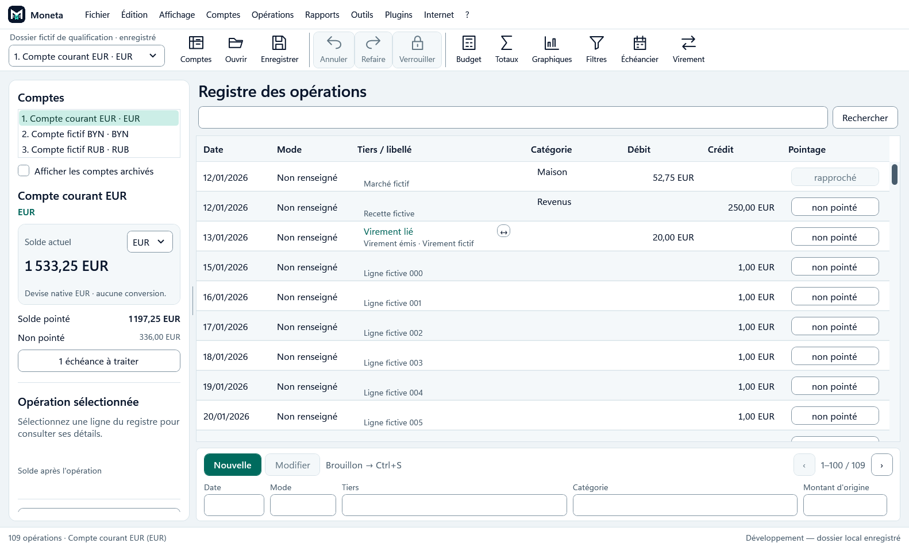
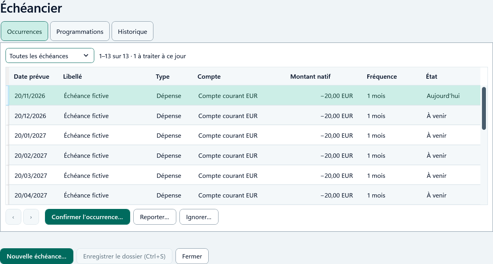
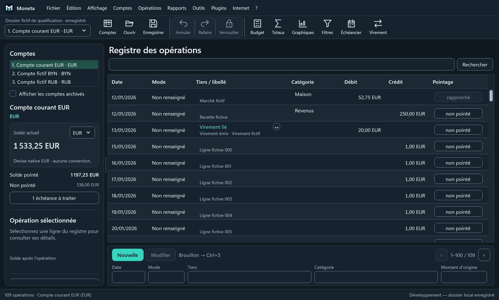

<a href="README.md">English</a>

  

<h1 align="center">Moneta</h1>

  <strong>Vos comptes, vos dépenses et vos budgets, simplement.</strong> 
  Une application Windows locale pour gérer vos finances personnelles.

  <a href="https://github.com/Roman-Cuisset/Moneta/releases/download/v0.1.0/Moneta-0.1.0-win-x64.exe"><strong>Télécharger Moneta Alpha 0.1.0 pour Windows</strong></a> 
  Windows 11 x64 · installateur autonome · runtime .NET inclus · aucun SDK requis

  
  
  
  

  <a href="https://moneta-site.pages.dev">Site officiel</a> ·
  <a href="https://github.com/Roman-Cuisset/Moneta/releases">Toutes les versions</a> ·
  <a href="docs/releases/0.1.0.md">Nouveautés</a> ·
  <a href="docs/ALPHA_GUIDE.md">Guide Alpha</a> ·
  <a href="CHANGELOG.md">Journal des versions</a>

Moneta réunit vos comptes, vos opérations, vos devises, vos budgets et vos sauvegardes dans une application de bureau. Vos dossiers financiers restent des fichiers locaux que vous choisissez et maîtrisez. Aucun compte en ligne n’est nécessaire.

## Un aperçu de Moneta

  

Le registre des opérations en thème clair. La capture utilise un dossier de démonstration fictif.

## Ce que Moneta permet de faire

### Comptes et opérations du quotidien

Gardez plusieurs comptes dans un même dossier, enregistrez recettes et dépenses, classez les écritures par catégorie et par tiers, et reliez les virements entre comptes. Pointez les opérations et rapprochez un compte de son relevé en fin de période. La recherche et les filtres permettent de retrouver une écriture rapidement, dans un compte ou dans tout le dossier.

### Plusieurs devises, une lecture claire

Gérez des comptes en **EUR**, **BYN** et **RUB**, en conservant chaque montant dans sa devise native. Les cours officiels NBRB et CBR peuvent être consultés par date et mis en cache pour un usage hors ligne. Les soldes convertis et les valeurs converties des rapports sont des estimations ; les opérations d’origine ne sont jamais réécrites.

### Budgets et rapports

Fixez des budgets mensuels par compte et par catégorie, puis comparez le prévu et le réalisé. Les rapports couvrent les flux, la répartition par catégorie, les graphiques, les soldes à date, les prévisions et des instantanés enregistrés que vous pouvez rouvrir. Comparez les mois et gardez un rapport figé comme référence.

### Opérations programmées

Programmez des dépenses, des recettes et des virements récurrents. Moneta affiche ce qui est à traiter et vous laisse confirmer, reporter ou ignorer chaque occurrence. Aucune écriture n’est ajoutée au dossier avant votre confirmation.

  

L’échéancier liste les occurrences à venir et attend une décision explicite.

### Sauvegardes et récupération

Créez une sauvegarde manuelle avec son manifeste, activez des sauvegardes automatiques versionnées après un enregistrement ou une fois par jour, et restaurez vers un nouveau fichier après vérification. Conservez toujours la sauvegarde et son manifeste ensemble. Les sauvegardes ne sont pas chiffrées : stockez-les sur un support protégé.

### Import BankPerfect

Ouvrez les dossiers BankPerfect V5 qui relèvent du périmètre pris en charge et convertissez-les dans un nouveau fichier `.moneta`. L’original reste inchangé. La compatibilité est volontairement partielle : le périmètre actuel couvre un sous-ensemble testé de dossiers EUR enregistrés par BankPerfect 8.0.0.373, et les fichiers non pris en charge sont refusés plutôt qu’approximés. [Périmètre et limites](docs/BANKPERFECT_QUALIFICATION_10E.md).

### Mises à jour intégrées

**Aide → Rechercher les mises à jour…** affiche les notes de version signées et permet de télécharger puis d’installer une nouvelle version depuis Moneta. Vous décidez du moment de l’installation. La recherche automatique au démarrage peut être désactivée dans les options.

### Vos données restent chez vous

Moneta ne nécessite aucun compte en ligne et n’envoie pas vos dossiers financiers à un serveur. L’accès réseau se limite aux points d’accès officiels des cours et au canal de mise à jour signé. Vous pouvez travailler hors ligne ; les cours déjà mis en cache restent disponibles.

  

Le même registre en thème sombre.

## Installation et premiers pas

1. Téléchargez **[Moneta-0.1.0-win-x64.exe](https://github.com/Roman-Cuisset/Moneta/releases/download/v0.1.0/Moneta-0.1.0-win-x64.exe)** et lancez-le. L’installation se fait pour votre compte Windows et inclut le runtime .NET ; Visual Studio et le SDK .NET ne sont pas nécessaires.
2. Ouvrez **Moneta** depuis le menu Démarrer.
3. Pour découvrir l’application sans créer de dossier, choisissez **Fichier → Mode démonstration**. La démonstration utilise des données fictives et ne peut pas enregistrer de modifications financières.
4. Pour commencer votre propre dossier, choisissez **Fichier → Nouveau dossier**, puis **Comptes → Ajouter un compte**.
5. Appuyez sur **Ctrl+S** pour enregistrer et choisir l’emplacement du fichier `.moneta`.

Pour importer un dossier BankPerfect compatible, utilisez **Fichier → Importer → BankPerfect (.bp)…**.

L’interface est actuellement en français ; les noms de menus ci-dessus sont ceux affichés dans l’application.

Moneta 0.1.0 n’est pas encore signé Authenticode et Windows peut afficher un avertissement SmartScreen concernant un éditeur inconnu. Vous pouvez vérifier l’installateur avec la [somme SHA-256 publiée](https://github.com/Roman-Cuisset/Moneta/releases/download/v0.1.0/SHA256SUMS.txt). En cas de doute, ne lancez pas le fichier. Ne désactivez pas les protections Windows pour installer Moneta.

## Alpha 0.1.0

Moneta est utilisable, mais encore jeune. **Windows 11 x64** est la seule cible qualifiée et l’interface est en **français**. Certaines fonctions peuvent évoluer. L’import BankPerfect se limite au périmètre V5 pris en charge et refuse les fichiers non pris en charge. Les conversions nécessitent un cours officiel ou un cache valide, et certains montants historiques inférieurs à l’unité minimale sont refusés plutôt qu’arrondis. Les dossiers et les sauvegardes ne sont pas chiffrés, et l’installateur ne porte pas encore de signature Authenticode.

Essayez d’abord Moneta avec un dossier fictif, conservez des sauvegardes indépendantes et vérifiez une restauration avant de l’utiliser avec des données importantes.

## Français et anglais dans les versions de développement

Le code en préparation pour la 0.2.0 prend en charge le français et l’anglais américain. Ouvrez **Outils → Options → Langue** ou **Tools → Options → Language**. Le changement s’affiche immédiatement. Enregistrez les options pour retrouver votre choix au prochain démarrage. [Langues et formats régionaux](docs/LOCALIZATION.md)

## Documentation et retours

- [Guide Alpha](docs/ALPHA_GUIDE.md) — installation, premiers pas et récupération.
- [Documentation technique](docs/) — architecture, formats de fichiers, import BankPerfect et rapports.
- [Journal des versions](CHANGELOG.md) et [notes de version](docs/releases/0.1.0.md).
- [Signaler un problème](https://github.com/Roman-Cuisset/Moneta/issues).
- [Archive du README technique](README_ARCHIVE.md) — historique détaillé des missions et des vérifications.

Les rapports de bogues et les retours précis sont bienvenus. Ne joignez jamais de dossier financier réel ni de donnée personnelle à un ticket.

## Licence

Moneta est distribué sous [licence MIT](LICENSE). Copyright © 2026 Roman Cuisset.

Les composants tiers conservent leurs licences et notices. La notice du codec BankPerfect V5 se trouve dans [src/Moneta.BankPerfect/THIRD-PARTY-NOTICE.md](src/Moneta.BankPerfect/THIRD-PARTY-NOTICE.md) ; les autres notices accompagnent l’installateur.

Moneta est un projet indépendant inspiré de [BankPerfect](https://chelly.net/bankperfect/). Il ne s’agit pas d’une version officielle et le projet n’est ni affilié ni approuvé par BankPerfect ou son auteur.

<a href="README.md">English</a> · <a href="https://github.com/Roman-Cuisset/Moneta/releases">Toutes les versions</a> · <a href="LICENSE">Licence MIT</a>

