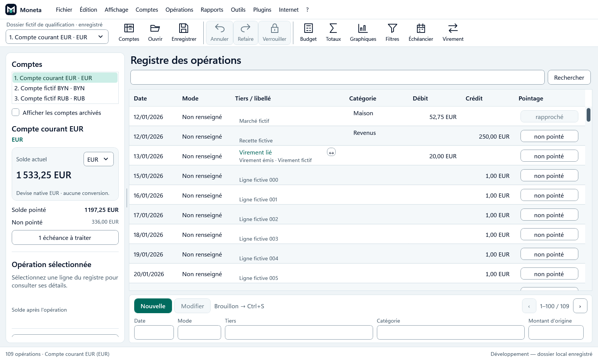
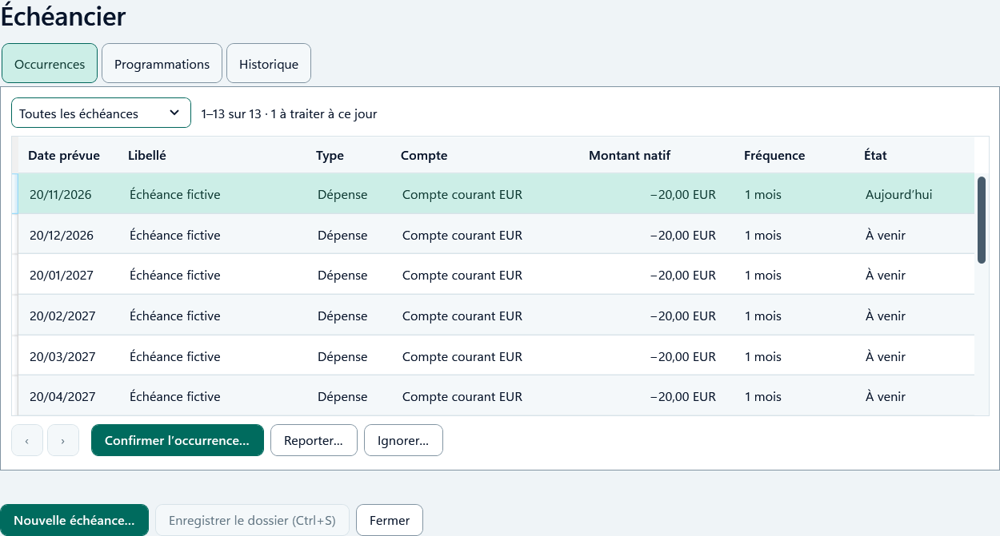
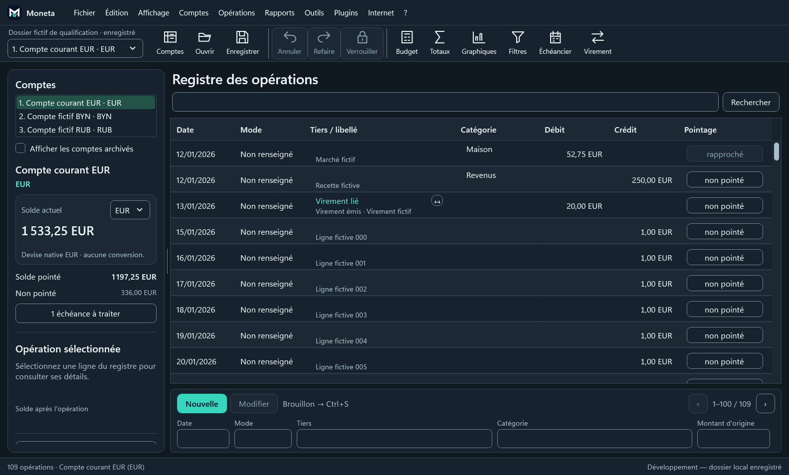

<a href="README.fr.md">Français</a>

  

<h1 align="center">Moneta</h1>

  <strong>Your accounts, spending, and budgets — simply.</strong> 
  A local-first Windows application for personal finances.

  <a href="https://github.com/Roman-Cuisset/Moneta/releases/download/v0.1.0/Moneta-0.1.0-win-x64.exe"><strong>Download Moneta Alpha 0.1.0 for Windows</strong></a> 
  Windows 11 x64 · standalone installer · .NET runtime included · no SDK required

  
  
  
  

  <a href="https://github.com/Roman-Cuisset/Moneta/releases">All releases</a> ·
  <a href="docs/releases/0.1.0.md">What’s new</a> ·
  <a href="docs/ALPHA_GUIDE.md">Alpha guide</a> ·
  <a href="CHANGELOG.md">Changelog</a>

Moneta brings your accounts, operations, currencies, budgets, and backups together in one desktop application. Your financial documents remain local files that you choose and control — no online account is required.

## A look at Moneta

  

The account register in the light theme. The screenshot uses a fictional demonstration document; the interface is in French.

## What Moneta helps you do

### Accounts and everyday operations

Keep several accounts in one document, record income and expenses, organise entries by category and payee, and link transfers between accounts. Mark operations as cleared and reconcile an account against its statement when you close a period. Search and filters help you find an entry quickly, across one account or the whole document.

### Several currencies, one clear view

Hold accounts in **EUR**, **BYN**, and **RUB**, and keep every amount in its native currency. Official NBRB and CBR rates can be looked up by date and cached for offline use. Converted balances and converted report values are estimates; the original operations are never rewritten.

### Budgets and reports

Set monthly budgets by account and category, then compare what you planned with what you spent. Reports cover cash flow, category breakdowns, charts, balances at a date, forecasts, and saved snapshots that can be replayed later. Compare months and keep a frozen report as a reference.

### Scheduled operations

Program recurring expenses, income, and transfers. Moneta shows what is due and lets you confirm, postpone, or skip each occurrence. No operation is added to the document until you confirm it.

  

The schedule lists upcoming occurrences and waits for an explicit decision.

### Backups and recovery

Create a manual backup with its manifest, enable versioned automatic backups after saving or once a day, and restore to a new file after verification. Keep the backup and its manifest together. Backups are not encrypted, so store them on a protected drive.

### BankPerfect import

Open BankPerfect V5 documents that fall within the supported scope and convert them into a new `.moneta` file. The original is left untouched. Compatibility is deliberately partial: the current scope covers a tested subset of EUR documents written by BankPerfect 8.0.0.373, and unsupported files are refused rather than approximated. [Qualified scope and limits](docs/BANKPERFECT_QUALIFICATION_10E.md) (French).

### Updates without leaving the app

**Aide → Rechercher les mises à jour…** displays the signed release notes and can download and install a new version from inside Moneta. You decide when to install. The automatic check at startup can be disabled in the options.

### Your data stays with you

Moneta does not require an online account and does not send your financial documents to a server. Network access is limited to the official exchange-rate endpoints and the signed update channel. You can work offline; rates already cached remain available.

  

Prefer a darker workspace? The same register in the dark theme.

## Install and first steps

1. Download **[Moneta-0.1.0-win-x64.exe](https://github.com/Roman-Cuisset/Moneta/releases/download/v0.1.0/Moneta-0.1.0-win-x64.exe)** and run it. It installs for your Windows user account and includes the .NET runtime; no Visual Studio or .NET SDK is required.
2. Open **Moneta** from the Start menu.
3. To explore without creating a document, choose **Fichier → Mode démonstration**. The demo uses fictional data and cannot save financial changes.
4. To start your own document, choose **Fichier → Nouveau dossier**, then **Comptes → Ajouter un compte**.
5. Press **Ctrl+S** to save and choose where the `.moneta` file will live.

To import a compatible BankPerfect document, use **Fichier → Importer → BankPerfect (.bp)…**.

The interface is currently in French, so the menu names above are shown as they appear in the application.

Moneta 0.1.0 is not yet Authenticode-signed, and Windows may show a SmartScreen warning about an unknown publisher. You can check the installer against the published [SHA-256 checksum](https://github.com/Roman-Cuisset/Moneta/releases/download/v0.1.0/SHA256SUMS.txt). If you are unsure, do not run the file. Do not disable Windows protections to install Moneta.

## Alpha 0.1.0

Moneta is usable, but still early. **Windows 11 x64** is the only qualified target, and its interface is in **French**. Some features may change. BankPerfect import covers only the supported V5 scope and refuses unsupported files. Conversions need an official rate or a valid local cache, and a few historical amounts below the smallest currency unit are rejected rather than rounded. Documents and backups are stored unencrypted, and the installer is not yet Authenticode-signed.

Try Moneta with a fictional document first, keep independent backups, and verify a restore before using it with important data.

## French and English in development builds

The code under development for 0.2.0 supports French and US English. Choose **Tools → Options → Language** in English or **Outils → Options → Langue** in French. The interface previews your choice immediately. Save to use it on your next launch. [Language and regional formats](docs/LOCALIZATION.md)

## Documentation and feedback

- [Alpha guide](docs/ALPHA_GUIDE.md) — installation, first steps, and recovery (French).
- [Technical documentation](docs/) — architecture, file formats, BankPerfect import, and reports (French).
- [Changelog](CHANGELOG.md) and [release notes](docs/releases/0.1.0.md).
- [Report an issue](https://github.com/Roman-Cuisset/Moneta/issues).
- [Earlier technical README](README_ARCHIVE.md) — detailed mission-by-mission verification record (French).

Bug reports and precise feedback are welcome. Please do not attach real financial documents or personal data to an issue.

## License

Moneta is released under the [MIT License](LICENSE). Copyright © 2026 Roman Cuisset.

Third-party components retain their own licenses and notices. The BankPerfect V5 codec notice is in [src/Moneta.BankPerfect/THIRD-PARTY-NOTICE.md](src/Moneta.BankPerfect/THIRD-PARTY-NOTICE.md); other notices ship with the installer.

Moneta is an independent project inspired by [BankPerfect](https://chelly.net/bankperfect/). It is not an official BankPerfect release and is not affiliated with or endorsed by BankPerfect or its author.

<a href="README.fr.md">Français</a> · <a href="https://github.com/Roman-Cuisset/Moneta/releases">All releases</a> · <a href="LICENSE">MIT License</a>

